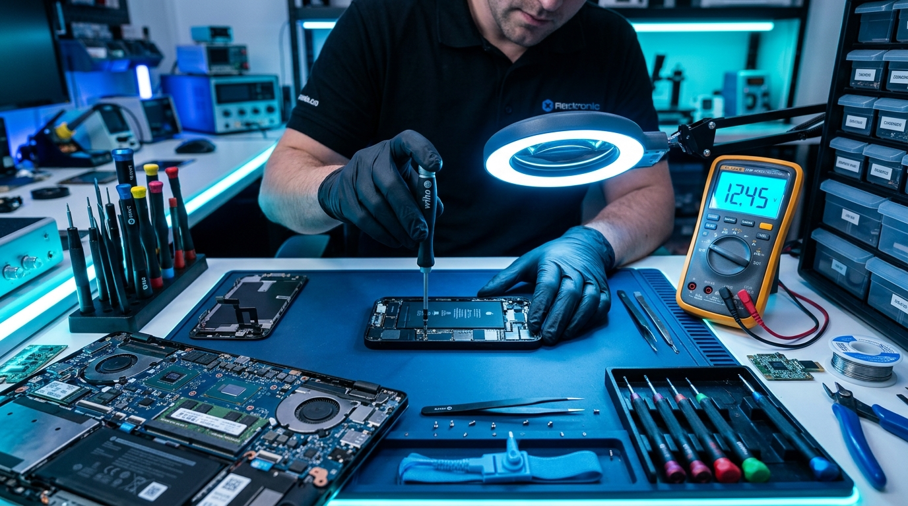

# TECH SPOT — One Solution For All 🛠️📱💻

Official showcase and portfolio website for **TECH SPOT**, Vandavasi's premier destination for computer & laptop services, smartphone repairs, CCTV security systems, and printer solutions.

---

## 🌟 About Tech Spot
Located in **Kottaimoolai, Vandavasi (Tamil Nadu – 604408)**, Tech Spot offers complete hardware, chip-level diagnostics, component upgrades, and security camera installations.

### 📱 Services Offered
- **Mobile Phone & Smartphone Care**: Screen & display replacement (OLED/AMOLED), battery upgrades, water damage revival, charging ports, and IC-level motherboard repairs.
- **Computer & Laptop Sales & Service**: Dell, HP, Lenovo, Acer, Asus, Apple MacBook (screen/keyboard repair, SSD & RAM upgrades, motherboard service).
- **CCTV Security Surveillance**: HD & IP dome/bullet cameras, DVR/NVR setup, remote mobile streaming.
- **Printer & Scanner Services**: Laser toner & ink tank cartridge refilling, roller & paper jam repair.
- **Software & Hardware Solutions**: Windows OS reinstallation, data recovery, antivirus, and driver diagnostics.

---

## 🕒 Store Working Hours
- **Monday – Sunday**: 9:00 AM – 10:00 PM (Open all 7 days)

---

## 📞 Contact & Location
- **Primary Phone**: 088381 18304
- **Secondary Phone**: 7010459742
- **Email**: techspot.vsi@gmail.com
- **Instagram**: [@tech_spot_14](https://www.instagram.com/tech_spot_14)
- **Google Maps Location**: [Open on Google Maps](https://maps.app.goo.gl/Q3oFP2dc4ivAiPGN6?g_st=awb)
- **Address**: Kottaimollai, Kottai Moolai, Vandavasi, Tamil Nadu – 604408, India

---

## 🚀 Technologies Used
- HTML5 & Semantic Elements
- Modern Vanilla CSS3 (Glassmorphism, CSS Grid, Responsive Design)
- JavaScript ES6+ (Live IST hours calculator, Repair Estimator & WhatsApp booking generator)
- FontAwesome 6 & Google Fonts
